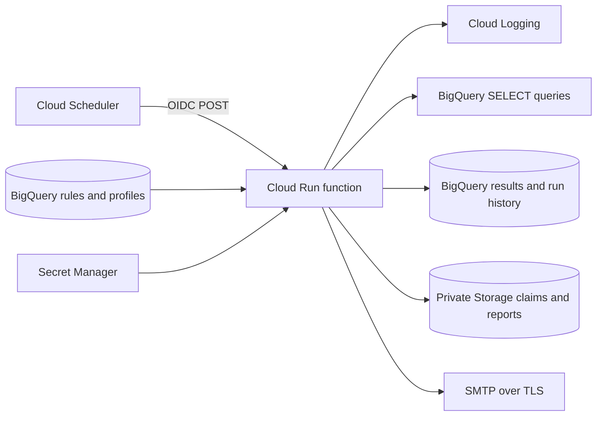

# GCP Metadata Monitor

[](https://github.com/GrabarzVIII/gcp-metadata-monitor/actions/workflows/ci.yml)

A Python **Cloud Run function** that reads monitoring rules from BigQuery, checks logs and data quality across GCP projects, and produces HTML reports for configured recipient profiles. Deploy directly from source with `gcloud run deploy --source . --function run_monitoring`.

The repository contains the function, SQL scripts, tests, and this deployment manual. Google builds the runtime using managed buildpacks; you do not maintain a Dockerfile, build pipeline, or Terraform stack.

## Supported checks

| Check | Observation |
|---|---|
| LOG | Number of entries matching a resource-scoped Cloud Logging filter |
| SQL_KPI | A numeric scalar returned by your SELECT query |
| FRESHNESS | Minutes since the latest data timestamp |
| ROW_COUNT | Number of records in the observation window |
| NULL_RATE | Fraction of records missing a specified value |
| DUPLICATES | Number of excess rows for a configured key |

A rule identifies the project, service type, resource name/link, check type, alarm comparison, threshold, and recipient profiles. Results distinguish **OK, ALERT, ERROR, and NO_DATA**. See [the rule reference](docs/RULES.md).

Service labels such as DATAFORM or WORKFLOWS do not imply native execution-status APIs. Use resource-scoped logs or SQL checks in this version. Metric adapters, business calendars, incident lifecycles, and per-rule schedules remain future work.



## Local setup

Use Python 3.11 or 3.12. Cloud deployment below uses Python 3.12.

```bash
git clone https://github.com/GrabarzVIII/gcp-metadata-monitor.git
cd gcp-metadata-monitor
python -m venv .venv
```

Activate with `.venv/Scripts/Activate.ps1` in PowerShell or `source .venv/bin/activate` on Linux/macOS. If PowerShell blocks activation, call `.\.venv\Scripts\python.exe` directly instead of changing the machine's execution policy.

```bash
python -m pip install -r requirements-dev.txt
python -m pytest -q
python -m src.cli demo
```

Open `reports/demo/daily_report.html`. This synthetic demo needs no cloud credentials and sends no email. The intentional failed check is included to demonstrate ERROR handling.

Run the real function locally:

```bash
functions-framework --target=run_monitoring --source=main.py --port=8080
```

`GET /healthz` does not initialize cloud clients. A POST to `/` with `{"preview":true}` evaluates live rules and therefore requires ADC and deployment settings. Copy `.env.example` to `.env` for local live testing. The local development server has no IAM authentication; keep it on a trusted machine.

## Deployment manual

The commands below are for **Bash / Google Cloud Shell**, from the repository root. Install a current Google Cloud CLI with Cloud Run function support. Use an existing project with billing enabled; replace every sample value with your own.

### 1. Choose configuration and enable APIs

```bash
export PROJECT_ID="your-monitoring-project"
export REGION="europe-west1"
export BQ_LOCATION="EU"
export DATASET_ID="monitoring"
export FUNCTION_NAME="gcp-metadata-monitor"
export STATE_BUCKET="$PROJECT_ID-monitor-state"
export RUNTIME_SA="gcp-monitor-runtime@$PROJECT_ID.iam.gserviceaccount.com"
export BUILDER_SA="gcp-monitor-builder@$PROJECT_ID.iam.gserviceaccount.com"
export SCHEDULER_SA="gcp-monitor-scheduler@$PROJECT_ID.iam.gserviceaccount.com"

gcloud auth login
gcloud config set project "$PROJECT_ID"
gcloud services enable run.googleapis.com cloudbuild.googleapis.com \
  artifactregistry.googleapis.com bigquery.googleapis.com logging.googleapis.com \
  storage.googleapis.com secretmanager.googleapis.com cloudscheduler.googleapis.com \
  iam.googleapis.com
```

Cloud Shell may already be authenticated. Local previews use `gcloud auth application-default login`. No service-account key files are needed.

An administrator must authorize initial setup: service-account creation, API enablement, resource creation, and IAM changes. Source deployment requires Cloud Run Source Developer, Service Usage Consumer, and permission to act as the runtime/build accounts. The operator creating Scheduler needs permission to act as its invoker account. See [Google's source deployment requirements](https://docs.cloud.google.com/run/docs/deploy-functions).

### 2. Create service accounts and a private state bucket

For a new installation:

```bash
gcloud iam service-accounts create gcp-monitor-runtime --display-name="Monitoring runtime"
gcloud iam service-accounts create gcp-monitor-builder --display-name="Function source builder"
gcloud iam service-accounts create gcp-monitor-scheduler --display-name="Scheduler invoker"

gcloud projects add-iam-policy-binding "$PROJECT_ID" \
  --member="serviceAccount:$BUILDER_SA" --role=roles/run.builder
gcloud projects add-iam-policy-binding "$PROJECT_ID" \
  --member="serviceAccount:$RUNTIME_SA" --role=roles/bigquery.jobUser

gcloud storage buckets create "gs://$STATE_BUCKET" --project="$PROJECT_ID" \
  --location="$REGION" --uniform-bucket-level-access --public-access-prevention
gcloud storage buckets add-iam-policy-binding "gs://$STATE_BUCKET" \
  --member="serviceAccount:$RUNTIME_SA" --role=roles/storage.objectUser
```

If resources already exist, inspect and reuse them rather than recreating them. Grant the deployer `roles/iam.serviceAccountUser` on the runtime/build accounts and the Scheduler operator that role on the Scheduler account when needed. Builder, runtime, and invoker identities have different duties.

### 3. Create tables with SQL

Edit the declarations at the top of [sql/01_tables.sql](sql/01_tables.sql), then run the full script in the BigQuery editor, selecting the matching query location. Alternatively, after editing:

```bash
bq query --project_id="$PROJECT_ID" --location="$BQ_LOCATION" \
  --use_legacy_sql=false < sql/01_tables.sql
```

The script creates the dataset and these tables:

| Table | Purpose |
|---|---|
| notification_profiles | Recipient addresses and report filtering |
| monitoring_rules | Resource identity, check configuration, thresholds, routing |
| monitoring_results | Observations and evaluated rule snapshots |
| monitoring_runs | Run status, counts, and delivery outcomes |

The two history tables are partitioned and default to 90-day retention. The script is safe to rerun: existing tables are preserved. It does not migrate their schema or change existing partition retention. SQL is the schema source of truth; generated JSON schemas and stored procedures are not required. The function executes SELECT queries directly.

### 4. Grant runtime access to data and logs

Adapt [sql/04_permissions.sql](sql/04_permissions.sql). Run the metadata grants in the metadata location; run each source-dataset grant separately in that dataset's location. The runtime can read metadata/source data and write only the two history tables. Do not give it write access to source datasets.

For each project whose logs will be checked:

```bash
export SOURCE_PROJECT="your-source-project"
gcloud services enable logging.googleapis.com --project="$SOURCE_PROJECT"
gcloud projects add-iam-policy-binding "$SOURCE_PROJECT" \
  --member="serviceAccount:$RUNTIME_SA" --role=roles/logging.viewer
```

Private audit logs and restricted log views may need additional scoped grants. Organization policies and VPC Service Controls must allow the intended cross-project reads. BigQuery queries are billed to the hosting project; each rule's location must match its source data.

### 5. Add rules and recipient profiles

Edit the declarations in [sql/02_sample_data.sql](sql/02_sample_data.sql), then run it in the metadata location. It inserts example checks for volume, freshness, a SQL KPI, and service errors. Re-running it preserves existing records and does not create duplicates.

Examples are disabled. Review the filters, source column types, recipient address, and thresholds before activation:

```sql
UPDATE `your-monitoring-project.monitoring.notification_profiles`
SET is_active = TRUE WHERE profile_id = 'data-team';
UPDATE `your-monitoring-project.monitoring.monitoring_rules`
SET is_active = TRUE WHERE rule_id = 'orders-count';
```

Only explicit TRUE values activate records. IDs must be unique and referenced profiles active. Configuration editors are trusted operators: their queries run with the runtime identity and their profiles control recipients. Validate exported rule JSON with `python -m src.cli validate examples/rules.json`; SQL syntax and permissions are checked during live preview.

### 6. Deploy the function from source

```bash
cp deploy.env.yaml.example deploy.env.yaml
```

Edit `deploy.env.yaml` to match your settings. Keep `NOTIFICATIONS_ENABLED: "false"`. Values must be strings; do not add the SMTP password. This file is ignored by Git and excluded from source uploads.

```bash
gcloud run deploy "$FUNCTION_NAME" --project="$PROJECT_ID" --region="$REGION" \
  --source=. --function=run_monitoring --base-image=python312 \
  --build-service-account="projects/$PROJECT_ID/serviceAccounts/$BUILDER_SA" \
  --service-account="$RUNTIME_SA" --env-vars-file=deploy.env.yaml \
  --no-allow-unauthenticated --timeout=1800 --memory=512Mi \
  --concurrency=1 --max-instances=1

export FUNCTION_URL="$(gcloud run services describe "$FUNCTION_NAME" \
  --project="$PROJECT_ID" --region="$REGION" --format='value(status.url)')"
```

Google manages source building and runtime artifacts. You do not run `docker build` or create an image URI. `.gcloudignore` uploads only `main.py`, `requirements.txt`, and `src/`. IAM authentication must remain enabled; do not grant `allUsers` or `allAuthenticatedUsers` access. When updating an existing service, inspect its IAM policy because existing public grants may need explicit removal.

### 7. Preview before sending email

An administrator can grant your testing identity `roles/run.invoker` on this function:

```bash
gcloud run services add-iam-policy-binding "$FUNCTION_NAME" --region="$REGION" \
  --member="user:YOUR_EMAIL" --role=roles/run.invoker

curl --fail-with-body -X POST "$FUNCTION_URL" \
  -H "Authorization: Bearer $(gcloud auth print-identity-token)" \
  -H "Content-Type: application/json" -d '{"preview":true}'
```

Preview reads live data and writes results/artifacts but sends no email. Inspect the returned `run_id`, the BigQuery history tables, and the private report:

```bash
gcloud storage cp "gs://$STATE_BUCKET/reports/RUN_ID/data-team.html" ./preview.html
```

Manual requests may specify `"window_end":"2026-01-02T08:00:00Z"`. Scheduled calls use their scheduled timestamp and cannot override it. Missing rules or invalid configuration return a visible error rather than a misleading successful empty run.

### 8. Configure SMTP and test delivery

Create the secret once, then add password versions outside source control:

```bash
gcloud secrets create gcp-monitor-smtp-password --replication-policy=automatic
read -r -s -p "SMTP password: " SMTP_PASSWORD
printf '\n'
printf '%s' "$SMTP_PASSWORD" | gcloud secrets versions add gcp-monitor-smtp-password --data-file=-
unset SMTP_PASSWORD

gcloud secrets add-iam-policy-binding gcp-monitor-smtp-password \
  --member="serviceAccount:$RUNTIME_SA" --role=roles/secretmanager.secretAccessor
```

Set SMTP host, port, user, sender, and TLS mode in `deploy.env.yaml`; set `NOTIFICATIONS_ENABLED: "true"`. Use STARTTLS/587 or SSL/465 as required by the provider. Verify sender/domain authorization with your provider.

```bash
# Replace 1 with the actual uploaded version.
gcloud run services update "$FUNCTION_NAME" --region="$REGION" \
  --env-vars-file=deploy.env.yaml --update-secrets=SMTP_PASS=gcp-monitor-smtp-password:1
```

Repeat the authenticated POST with `{"preview":false}` and confirm delivery. Both this flag and the environment setting must allow email. Do not blindly repeat a timed-out delivery request; inspect run state and the SMTP provider first.

### 9. Schedule the function

Create the schedule after validating the function and report recipients:

```bash
gcloud run services add-iam-policy-binding "$FUNCTION_NAME" --region="$REGION" \
  --member="serviceAccount:$SCHEDULER_SA" --role=roles/run.invoker

gcloud scheduler jobs create http gcp-monitor-daily --location="$REGION" \
  --schedule='0 8 * * *' --time-zone='Europe/Warsaw' \
  --uri="$FUNCTION_URL" --http-method=POST \
  --oidc-service-account-email="$SCHEDULER_SA" --oidc-token-audience="$FUNCTION_URL" \
  --headers='Content-Type=application/json' --message-body='{"preview":false}' \
  --attempt-deadline=1800s --max-retry-attempts=0 --max-retry-duration=0s
```

For an initial scheduled preview, use `{"preview":true}` instead. Creation activates the schedule; use `gcloud scheduler jobs pause gcp-monitor-daily --location="$REGION"` when needed. Keep the audience equal to the base function URL. Preserve the Google-managed Scheduler service agent role.

Each rule uses a rolling window. A 1,440-minute window is not the previous local calendar day; DST changes can cause daily overlap/gaps. Use UTC scheduling for fixed daily windows or explicit calendar SQL.

## Operations, limits, and validation

- SQL limits default to 1 GiB scanned per query and a 60-second result wait. Cancellation is best effort and queries can incur charges. Only one scalar SELECT is accepted.
- Log reads use one deadline across pages and a 10,000-entry limit; truncation is an ERROR, never a fabricated exact count.
- Evaluations are sequential with a 25-minute orchestration budget, leaving time for persistence inside the 30-minute HTTP deadline. Use modest rule sets. Individual API operations and retries can extend beyond the orchestration budget.
- Results use one BigQuery load job per run. The function retains partial observations on graceful failure, checkpoints delivery progress, and attempts a terminal Storage state even when BigQuery history is unavailable.
- Duplicate scheduled runs are claimed atomically. SMTP and state writes are not a transaction: exactly-once email is not guaranteed. Failed/interrupted claims need operator inspection.
- Configure independent alerts for failed Scheduler requests and missing completion logs. GET /healthz checks process liveness only.
- Storage objects have no automatic expiry in this manual. Configure report retention separately from claims; deleting claims shortens the deduplication horizon.

See [operations and recovery](docs/OPERATIONS.md) and [operational SQL](sql/03_operational_queries.sql). Source builds, runtime requests, BigQuery, Storage, Secret Manager, and SMTP can incur charges. Existing Terraform-managed installations require an explicit ownership/migration decision before using manual gcloud updates; removing repository files does not destroy their infrastructure.

```bash
ruff check main.py src tests
ruff format --check main.py src tests
python -m pytest -q
```

CI tests Python 3.11/3.12 on Windows/Linux and loads the function using only production requirements. It does not deploy cloud resources or send email. Local tests mock cloud APIs; live SQL execution, GCP IAM, source builds, and SMTP delivery must be verified in your own project.

MIT license; see [LICENSE](LICENSE).
