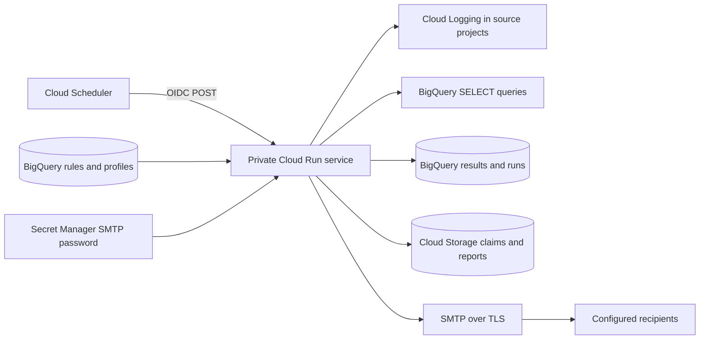

# GCP Metadata Monitor

[](https://github.com/GrabarzVIII/gcp-metadata-monitor/actions/workflows/ci.yml)

Monitor Google Cloud logs and BigQuery data quality across projects using rules stored in BigQuery. Each rule identifies the project, service, resource, console link, check type, and alarm condition. Reports are routed to configured email profiles.

**Status: deployable MVP.** Tests cover the engine and mocked cloud boundaries. Terraform configuration is validated. Live cloud integration and SMTP delivery must be verified in your own environment. No resources are deployed automatically by this repository's CI.

## Features

- Resource-scoped log counts for Cloud Run, Scheduler, Workflows, Dataform, or other matching logs.
- Scalar SQL KPIs and templates for freshness, row counts, null rates, and duplicate counts.
- Explicit `OK`, `ALERT`, `ERROR`, and `NO_DATA` outcomes.
- Per-profile HTML reports with resource links, observations, thresholds, and owners.
- Rule snapshots and execution history in BigQuery; private reports in Cloud Storage.
- BigQuery dry runs, SELECT-only validation, query deadlines, and scan limits.
- Atomic scheduled-run claims to prevent duplicate concurrent processing.
- Cloud Run, Scheduler OIDC authentication, dataset-scoped IAM, and Secret Manager.
- Offline demo, tests, Docker image, Terraform, and GitHub Actions CI.

Direct Cloud Monitoring metrics, native execution-status APIs, incident lifecycles, business calendars, and per-rule schedules are **not implemented in this MVP**. See [the roadmap](docs/ROADMAP.md). `service_type` describes the resource; it does not automatically select an API adapter.

## Architecture



One `monitoring_rules` row represents one check. Several rows may monitor the same resource. Query billing belongs to the hosting project; source datasets remain in their original projects. A rule's `location` must match the queried BigQuery data. Metadata can use a separate location.

## Try locally without GCP

Requires Python 3.11 or 3.12 and Git. Tested dependencies are recorded in `constraints.txt`.

```bash
git clone https://github.com/GrabarzVIII/gcp-metadata-monitor.git
cd gcp-metadata-monitor
python -m venv .venv
```

Activate in Windows PowerShell:

```powershell
.\.venv\Scripts\Activate.ps1
```

Activate in Linux/macOS:

```bash
source .venv/bin/activate
```

Then:

```bash
python -m pip install -c constraints.txt -e ".[dev]"
python -m pytest -q
python -m src.cli demo
```

Open `reports/demo/daily_report.html`. Synthetic results include a success, an alarm, missing data, and an intentional query failure. The demo does not contact GCP or send email. `results.json` contains the observations. The intentional failure also produces an error log line.

## Deploy to your GCP environment

The following commands use Bash and work in Google Cloud Shell. Terraform commands also work in PowerShell with the corresponding variable syntax. Install Google Cloud CLI and Terraform >= 1.6, < 2.0. Docker is optional when using Cloud Build.

### 1. Prerequisites and access

Choose an existing hosting project with billing enabled and existing source projects/datasets. The deployer needs permission to enable APIs, create the resources declared by Terraform, and update IAM in the hosting project and on selected source projects/datasets. Have your administrator grant appropriate scoped administrative roles for your organization. Acting as the runtime, Scheduler, and builder accounts requires `iam.serviceAccounts.actAs`. Submitting builds requires Cloud Build permissions and write access to the build-source bucket.

Runtime access is deliberately narrower:

| Identity | Access |
|---|---|
| Runtime | BigQuery jobs in hosting project; metadata read; history-table write; selected source-dataset read; selected project logs read; state objects; one SMTP secret |
| Scheduler | Invoke this Cloud Run service |
| Builder | Read build-source bucket, write image repository, write build logs |

Do not grant `allUsers` the Cloud Run invoker role. The app relies on Cloud Run IAM and must not be exposed directly on an unauthenticated public server. Enable the Logging API in source projects when needed. Private audit logs or custom log views may need additional scoped permissions. Organization policies and VPC Service Controls must permit cross-project access.

```bash
gcloud auth login
gcloud auth application-default login
export PROJECT_ID="your-monitoring-project"
export REGION="europe-west1"
gcloud config set project "$PROJECT_ID"
gcloud auth application-default set-quota-project "$PROJECT_ID"
```

Cloud Shell's existing authentication may be sufficient. Do not download service-account keys for Cloud Run.

### 2. Bootstrap the image repository

```bash
terraform -chdir=terraform/bootstrap init
terraform -chdir=terraform/bootstrap plan \
  -var="project_id=$PROJECT_ID" -var="region=$REGION" -out=bootstrap.tfplan
terraform -chdir=terraform/bootstrap apply bootstrap.tfplan

export IMAGE="$(terraform -chdir=terraform/bootstrap output -raw image_repository)/engine:v0.1.0"
export BUILD_SA="$(terraform -chdir=terraform/bootstrap output -raw build_service_account)"
export BUILD_BUCKET="$(terraform -chdir=terraform/bootstrap output -raw build_source_bucket)"
```

Bootstrap and application have separate Terraform states. Keep both private and backed up. For teams, configure a remote backend with locking before collaborating. Local state/plans are ignored by Git.

### 3. Build the image

From the repository root:

```bash
gcloud builds submit . --project="$PROJECT_ID" --region="$REGION" \
  --config=cloudbuild.yaml --substitutions="_IMAGE=$IMAGE" \
  --service-account="$BUILD_SA" \
  --gcs-source-staging-dir="gs://$BUILD_BUCKET/source"
```

Use a new image tag for each release and preferably set Terraform's `image` to its immutable digest. Build ignore files exclude environments, Terraform state, and `.env` files.

### 4. Deploy infrastructure

```bash
cp terraform/terraform.tfvars.example terraform/terraform.tfvars
```

Edit the copy: set project, region, built image URI, source projects/datasets, and schedule/timezone. Keep `scheduler_paused = true` and `notifications_enabled = false` initially. Sample identifiers must be replaced.

```bash
terraform -chdir=terraform init
terraform -chdir=terraform plan -out=deployment.tfplan
terraform -chdir=terraform apply deployment.tfplan
terraform -chdir=terraform output
```

Terraform creates all four BigQuery tables from `sql/schemas/*.json`. Do not run the DDL separately. `sql/01_tables.sql` is an alternative for externally managed BigQuery; import existing tables before managing them with Terraform.

The default schedule is 08:00 `Europe/Warsaw`. Rules use rolling windows ending at the scheduled timestamp, excluding that endpoint. A 1,440-minute window is **not** the previous local calendar day. DST transitions can cause overlap or gaps between daily windows; use UTC scheduling for uniform windows or explicit calendar SQL.

### 5. Add profiles and rules

Adapt `sql/02_sample_data.sql` in the BigQuery editor, replacing all identifiers and recipient addresses. Samples are disabled by default. Enable a reviewed profile and rule:

```sql
UPDATE `your-monitoring-project.monitoring.notification_profiles`
SET is_active = TRUE WHERE profile_id = 'data-team';
UPDATE `your-monitoring-project.monitoring.monitoring_rules`
SET is_active = TRUE WHERE rule_id = 'orders-count';
```

IDs must be unique; the engine checks this because BigQuery does not enforce it here. Nullable omitted fields use application defaults. Only rows with explicit `is_active = TRUE` are loaded. Referenced profiles must be active. Restrict metadata editing to trusted operators: SQL executes with the runtime's data access and profiles determine recipients.

See [the rule guide](docs/RULES.md) for templates, comparisons, and SQL examples.

### 6. Preview

An administrator can grant your testing identity permission to invoke the service:

```bash
gcloud run services add-iam-policy-binding gcp-metadata-monitor \
  --project="$PROJECT_ID" --region="$REGION" \
  --member="user:YOUR_EMAIL" --role=roles/run.invoker
```

Then:

```bash
export SERVICE_URL="$(terraform -chdir=terraform output -raw service_url)"
curl --fail-with-body -X POST "$SERVICE_URL/run-monitoring" \
  -H "Authorization: Bearer $(gcloud auth print-identity-token)" \
  -H "Content-Type: application/json" -d '{"preview":true}'
```

Inspect the returned `run_id` in `monitoring_results` and `monitoring_runs`. Download its private report:

```bash
export STATE_BUCKET="$(terraform -chdir=terraform output -raw state_bucket)"
gcloud storage cp "gs://$STATE_BUCKET/reports/RUN_ID/data-team.html" ./preview.html
```

Preview executes queries, incurs normal costs, and writes history/reports, but sends no email. Manual requests get new run IDs. Add `"window_end":"2026-01-02T08:00:00Z"` to inspect a fixed historical window.

For a local live preview, copy `.env.example` to `.env`, set deployment values, authenticate through ADC, and run `python -m src.cli preview`. Your local identity needs the appropriate permissions. Do not commit `.env`.

### 7. Configure SMTP

Terraform initially creates an empty secret. Add a password outside Terraform so it does not enter state or shell history:

```bash
read -r -s -p "SMTP password: " SMTP_PASSWORD
printf '\n'
printf '%s' "$SMTP_PASSWORD" | gcloud secrets versions add gcp-monitor-smtp-password \
  --project="$PROJECT_ID" --data-file=-
unset SMTP_PASSWORD
```

Set `smtp_host`, `smtp_port`, `smtp_user`, `smtp_from`, and `smtp_security` in your private `.tfvars`. Use STARTTLS/587 or SSL/465 according to your provider. Pin `smtp_secret_version` to the uploaded version for controlled rollout. Set `notifications_enabled = true`, keep Scheduler paused, then review and apply Terraform again.

Make one deliberate delivery test using `{"preview":false}`. Verify recipients and sender/domain verification with your SMTP provider. Sending requires both `preview:false` and `NOTIFICATIONS_ENABLED=true`.

### 8. Enable scheduling

Set `scheduler_paused = false`, review the plan, and apply. Verify the first scheduled execution. Configure independent alerts for failed Scheduler requests and missing daily successful runs. The service logs `monitor_run_finished run_id=... status=COMPLETED` after history persistence. `/healthz` only checks process liveness.

Read [the operations guide](docs/OPERATIONS.md): interrupted runs are not automatically replayed because SMTP delivery and state persistence cannot form an exactly-once transaction.

## Development

```bash
ruff check src tests scripts
ruff format --check src tests scripts
python -m pytest -q
python scripts/generate_schemas.py
terraform fmt -check -recursive terraform
terraform -chdir=terraform init -backend=false
terraform -chdir=terraform validate
terraform -chdir=terraform/bootstrap init -backend=false
terraform -chdir=terraform/bootstrap validate
```

CI checks Python on Linux/Windows, validates both Terraform roots, builds the container, and executes its offline demo. No cloud credentials are needed. See [CONTRIBUTING.md](CONTRIBUTING.md) for the branch workflow.

## Limits and costs

- Designed for modest scheduled rule sets. Execution is sequential with a 25-minute orchestration budget and 30-minute Cloud Run/Scheduler deadline. An individual API call can outlive the orchestration budget; size deployments conservatively.
- Log checks read matching entries with a default 10,000-entry cap. Exceeding it is an ERROR, not an approximate count. Use metrics or aggregate tables at higher volume.
- SQL defaults: 1 GiB scan cap per query and 60-second result wait. Cancellation is best-effort and may still incur costs. Freshness checks can scan history; use a compact ingestion-audit table for large sources.
- BigQuery, Cloud Run, builds, Storage, Secret Manager, and SMTP can incur costs. A query scan cap is not a project budget.
- History partitions expire after 90 days by default. Claims/reports expire after 90 days, limiting the deduplication horizon.
- This is scheduled operational/data-quality reporting; immediate infrastructure alerting remains a separate responsibility.

## References and license

- [BigQuery cost controls](https://docs.cloud.google.com/bigquery/docs/best-practices-costs)
- [Scheduler delivery semantics](https://docs.cloud.google.com/scheduler/docs/overview)
- [Cloud Run scheduling](https://docs.cloud.google.com/run/docs/triggering/using-scheduler)
- [Terraform Google provider](https://registry.terraform.io/providers/hashicorp/google/latest/docs)

MIT license; see [LICENSE](LICENSE).
